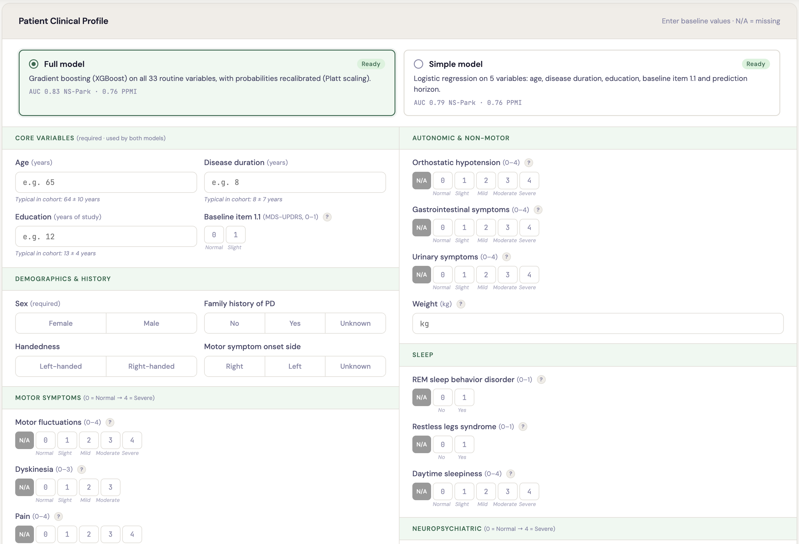
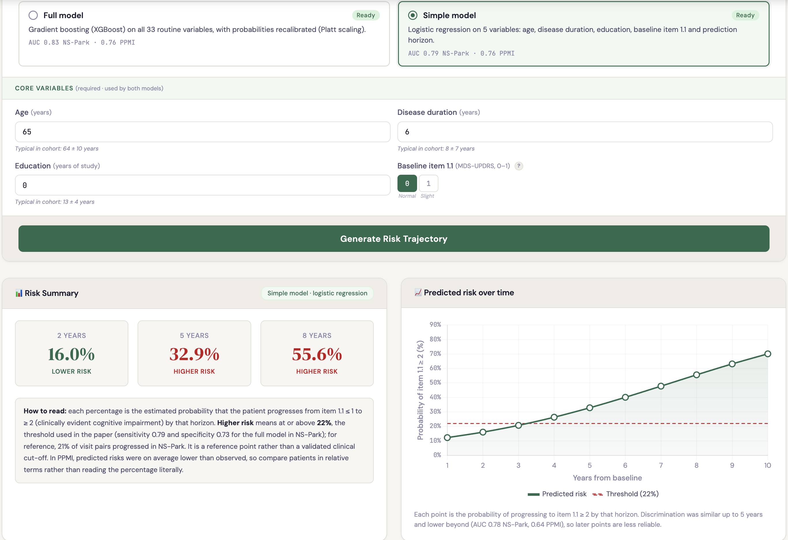

# NS-Park Cognitive Risk Predictor

A web interface estimating, for a patient with Parkinson's disease, the risk of progressing from no or only subjective cognitive complaints (MDS-UPDRS item 1.1 ≤ 1) to clinically evident cognitive impairment (item 1.1 ≥ 2), using only variables collected in routine consultations.

🔗 **[Live tool](https://rlouiset.github.io/nspark-scd-predictor/)**

### Clinical Input Form


### Risk Prediction Results


## About

This tool implements the models from:

> Louiset R, et al. *Predicting Future Cognitive Impairment in Parkinson's Disease From Routine Clinical Assessments.* 2026.

Both models were trained on the **NS-Park** French cohort (2,593 patients; 21,626 pairs of visits more than one year apart) and applied without retraining to the **PPMI** cohort (993 patients).

The clinician can choose between two models:

| | Full model | Simple model |
|---|---|---|
| Method | XGBoost (500 trees, depth 15), Platt-recalibrated | Logistic regression |
| Inputs | 33 routine variables + prediction horizon | Age, disease duration, education, baseline item 1.1 + prediction horizon |
| AUC, NS-Park test set | 0.83 (95% CI 0.80–0.86) | 0.79 (0.75–0.83) |
| AUC, PPMI | 0.76 (0.73–0.79) | 0.76 (0.73–0.79) |
| Feature contributions | Exact TreeSHAP (path-dependent) | Exact linear terms (coefficient × standardised value) |

## Features

- **Model choice**: full model with all variables, or simple 5-variable model that only needs the core inputs
- **Risk trajectory**: probability of item 1.1 ≥ 2 for horizons of 1 to 10 years, with the paper's 22% threshold shown for reference
- **Feature contributions**: per-patient explanation of what drives the prediction
- **Missing data**: the full model handles unknown values natively; age, disease duration, education and baseline item 1.1 are required, and sex is also required for the full model
- **Privacy**: all computation runs in the browser; no data leaves the device

## Input variables (full model)

| Category | Variables |
|----------|----------|
| Core (both models) | Age, disease duration, education, baseline MDS-UPDRS item 1.1 (0–1) |
| Demographics & history | Sex, family history of PD, handedness, motor symptom onset side |
| Motor | Motor fluctuations, dyskinesia, pain, dysarthria, freezing, falls/postural instability, postural deformity, swallowing |
| Autonomic | Orthostatic hypotension, gastrointestinal symptoms, urinary symptoms, weight |
| Sleep | REM sleep behaviour disorder, restless legs, daytime sleepiness |
| Neuropsychiatric | Apathy, depression, anxiety, hallucinations/psychosis, impulse control, dopaminergic addiction, punding |
| Staging & treatment | Hoehn & Yahr ON/OFF, total LEDD |

## Technical details

- `model.json`: the XGBoost trees exported from `nspark_best_model.pkl`, with node cover values (needed for TreeSHAP) and the Platt calibration coefficients (a = −1.2515, b = 0.4857).
- The logistic regression coefficients (from `nspark_lr_model.pkl`) are embedded in `index.html`.
- The JavaScript implementation was checked against Python on 300 synthetic patients with up to 30 missing variables: XGBoost margins within 5×10⁻⁶, calibrated probabilities within 10⁻⁶, TreeSHAP values within 2×10⁻⁶ of `shap.TreeExplainer`, logistic regression identical to scikit-learn.
- `pat_sexe` is coded 0 = female, 1 = male, as in the training data.

## Deployment on GitHub Pages

1. Fork or clone this repository
2. Go to **Settings → Pages**
3. Set source to **Deploy from a branch** → `main` / `root`
4. The tool will be live at `https://<username>.github.io/nspark-scd-predictor/`

When `model.json` is replaced, change `MODEL_VERSION` in `index.html` so that browsers do not keep a cached copy of the old model.

## ⚠️ Disclaimer

This tool is for **research purposes only**. It is not a certified medical device and does not replace clinical judgment or formal cognitive assessment. Item 1.1 is a clinician-rated screening item, not a diagnosis of SCD or PD-MCI, and predicted risks were on average lower than observed in PPMI: estimates are best interpreted in relative terms in new populations.

## Citation

```
@article{louiset2026predicting,
  title={Predicting Future Cognitive Impairment in Parkinson's Disease From Routine Clinical Assessments},
  author={Louiset, Robin and Massart, Renaud and Cacciamani, Federica and others},
  year={2026}
}
```

## License

This research tool is provided for academic and clinical research use.
